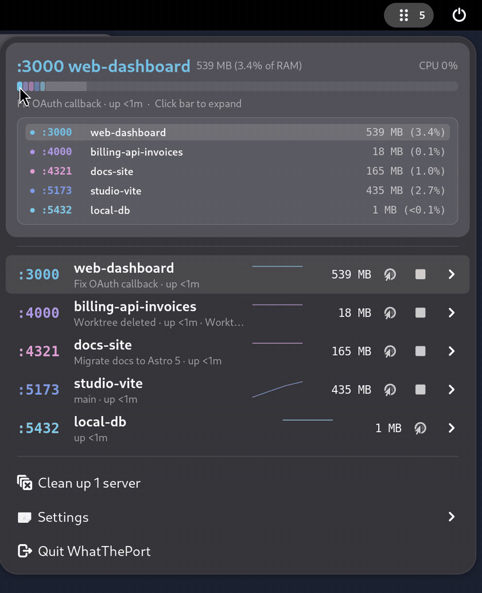
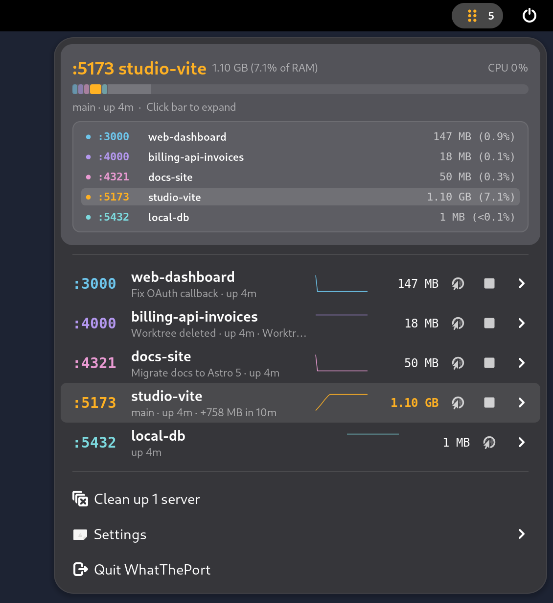
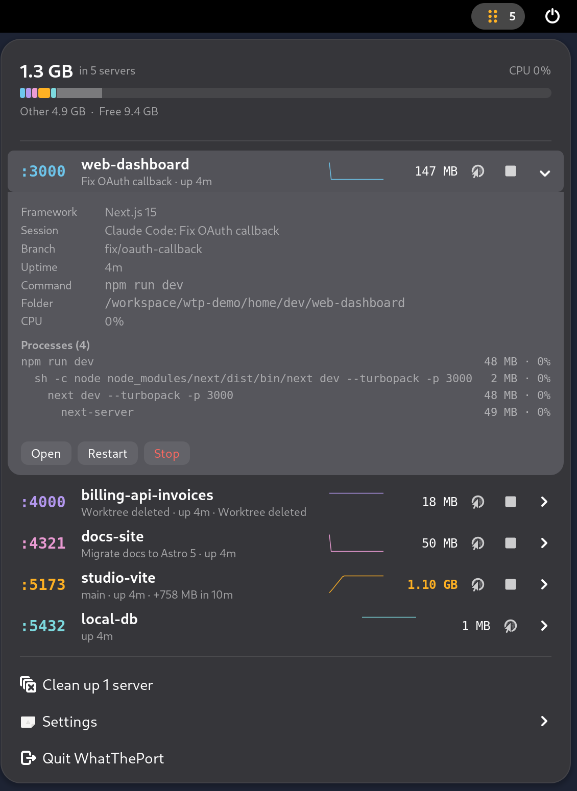
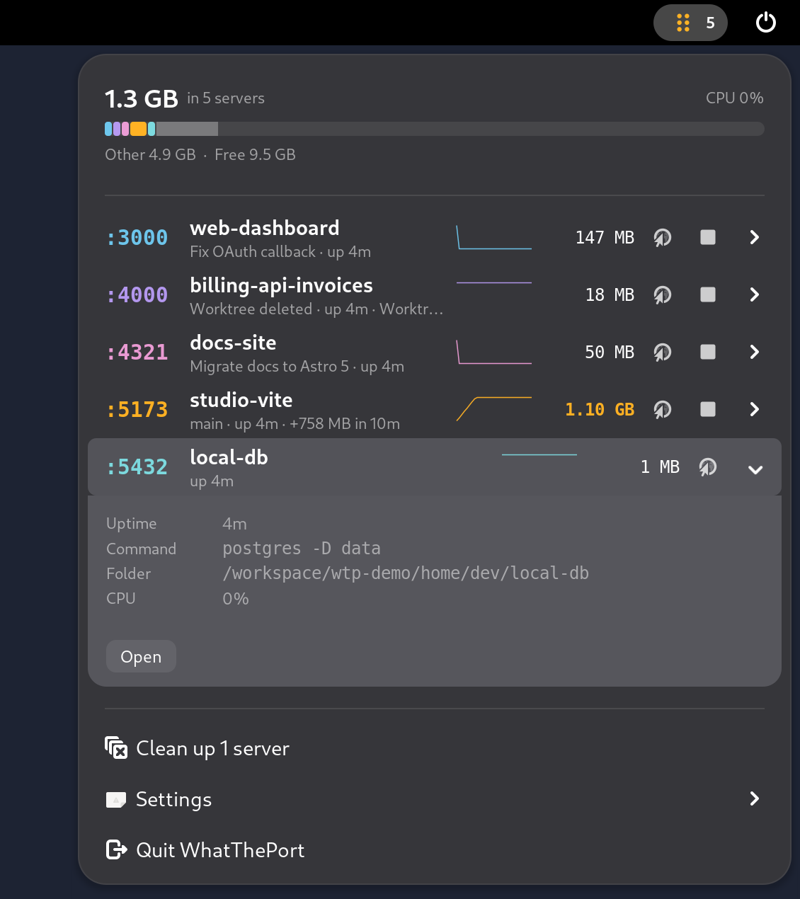
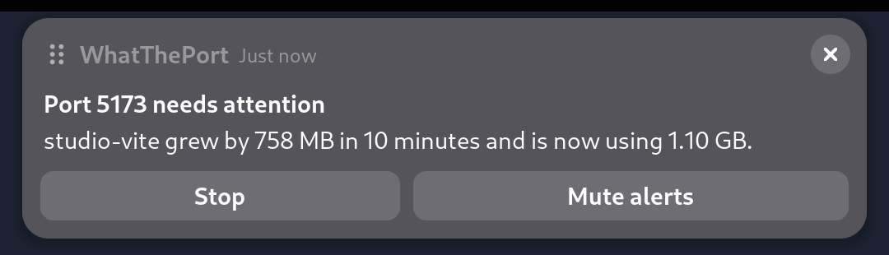
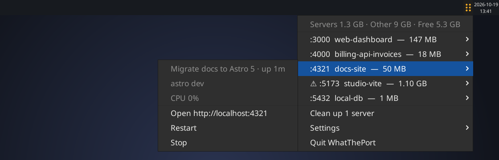
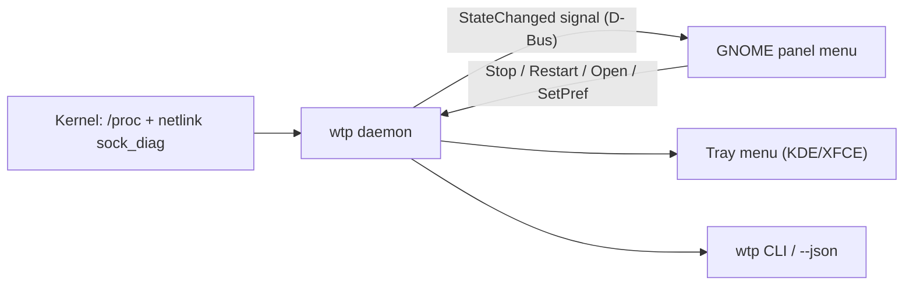

<div align="center">

# WhatThePort for Linux

**Every dev server on your machine, one click away in the top bar.**

Find the forgotten `next dev`, `vite` and `uvicorn` processes your AI agents left running, see what they cost in memory, and stop them in one click.

A Linux port of [WhatThePort](https://github.com/tomjohndesign/what-the-port): a single Rust binary plus a GNOME Shell panel menu.

[](#requirements)
[](#build-from-source)
[](LICENSE)



</div>

---

## Why?

Open a few coding agents against different git worktrees and you end up with a pile of `next dev`,
`vite`, `uvicorn` and `cargo` processes still running long after you moved on. They sit there holding
ports and RAM, and nothing tells you where they came from. The usual fix is to find them by hand and
hope you picked the right PID.

WhatThePort keeps that list in front of you. It shows what is listening on each port, which project
and branch it belongs to, which agent session started it, how much memory it is using, and whether it
has gone idle or started leaking. From there you can open it, restart it, or kill the whole process
tree in one click.

## Features

- **Colour-coded memory bar.** One segment per server, coloured to match its row, next to everything else using RAM and what is free. Hover the bar to see every running server with its memory and share of RAM; click a segment to expand that server.
- **Process trees.** Wrapper chains such as `npm run dev` → `sh -c` → `next dev` → `next-server` are reported as one server with combined memory and CPU.
- **Projects and branches.** Names come from `package.json`, `pyproject.toml`, `Cargo.toml`, `go.mod`, `Gemfile` and `.git/HEAD`, including linked worktrees. Frameworks such as Next.js, Vite and Astro are detected from your dependencies.
- **Agent sessions.** Servers started by Claude Code (`CLAUDE_CODE_SESSION_ID`) or Codex show the conversation title. Codex uses `CODEX_THREAD_ID` when the process inherited it, otherwise the chat in that folder that was already open when the process started. If several chats share the folder and the one that started the server cannot be told apart, the title is prefixed with `~` and `session_estimated` is true in `wtp --json`.
- **Leak and memory alerts.** A desktop notification with **Stop** and **Mute alerts** buttons appears when a server passes the memory threshold (default 2 GB) or grows by more than 500 MB inside the 10-minute history. The notification names the server (port, project or command, and the linked Claude Code or Codex session when one is known) and labels what was measured: resident memory of the process tree (`Total memory: 1.4 GB`), the change over the actual sample window (`Current change: +120 MB in the last 5 min`), and CPU plus share of RAM (`CPU 35% · 9.0% of RAM`). The same server is not notified again until `snooze_minutes` have passed and usage has climbed by a meaningful step (at least 256 MB or 25%, whichever is larger). A later alert updates the previous notification instead of stacking a new one. These are memory figures, not network traffic.
- **Clean up.** Servers from deleted worktrees, idle ones and long-running ones are suggested for cleanup, or stopped automatically if you choose.
- **Databases are protected.** `postgres`, `redis-server`, `mysqld`, `mariadbd`, `mongod` and `docker-proxy` are never stopped or restarted, and you can add your own.
- **Stop and restart.** Stop sends SIGTERM to the whole tree, then SIGKILL after 3 seconds to anything still running. Restart re-runs the original command in its original folder, logging to `~/.local/state/whattheport/port-N.log`.
- **Docker.** Published container ports show the container name and image, with memory read from the container.
- **Terminal and scripts.** `wtp` lists everything in the terminal, and `wtp --json` feeds Waybar, Polybar, tmux or your own scripts.

## Screenshots

### GNOME panel menu

| Hover the memory bar | Expand a server |
| :---: | :---: |
|  |  |
| **Protected database: no Stop or Restart** | **Leak alert** |
|  |  |

### Tray menu (KDE Plasma, XFCE, Cinnamon and others)




### Terminal


## Requirements

- Linux with `/proc` (any modern distribution)
- GNOME Shell 45 to 50 for the panel menu, or any desktop with a StatusNotifier tray
- Rust 1.88+ to build (`curl --proto '=https' --tlsv1.2 -sSf https://sh.rustup.rs | sh`)
- Optional: GitHub CLI (`gh`) for pull request and Vercel preview links

There are no runtime dependencies: no Python, GTK or `ss`.

## Install

### With the install script (recommended)

```bash
git clone https://github.com/devgg003/whattheport-linux.git
cd whattheport-linux
./install.sh
```

The installer builds the binary, installs `~/.local/bin/wtp`, the icons, an app launcher entry and the GNOME extension, removes any old Python version, and starts the service. On GNOME, log out and back in once so the shell loads the extension.

Launch **WhatThePort** from the app grid to start it again after quitting, or turn on **Settings → Launch at login**.

`./install.sh --uninstall` removes everything except your settings.

### Build from source

```bash
cargo build --release   # target/release/wtp
cargo test
```

Then run `target/release/wtp daemon` for the background service, or just `target/release/wtp` to list servers. The GNOME extension lives in `gnome-extension/whattheport@local/`; `install.sh` copies it to `~/.local/share/gnome-shell/extensions/` and enables it.

## Usage

```console
$ wtp
:3000  web-dashboard            147 MB      0%  Fix OAuth callback · up 1m
:4000  billing-api-invoices      18 MB      0%  Worktree deleted · up 1m · clean up: Worktree deleted
:4321  docs-site                 50 MB    0.5%  Migrate docs to Astro 5 · up 1m
:5173  studio-vite             1.10 GB      0%  main · up 1m · Total memory: 1.1 GB · Current change: +750 MB in the last 10 min · CPU 0% · 9.0% of RAM · clean up: +750 MB in the last 10 min
:5432  local-db                   1 MB      0%  up 1m

1.3 GB in servers · 5.2 GB other · 9.1 GB free · CPU <0.1%
```

Each row also includes the labeled figures `Total memory`, `Current change` (with the real sample window), and `CPU · % of RAM`. `wtp --json` adds `total_memory_label`, `memory_change_label`, `resources_label`, `memory_delta_bytes`, `memory_window_seconds` and `ram_percent` beside the existing `memory`, `memory_bytes`, `cpu` and `growth` keys.

| Command | What it does |
| :--- | :--- |
| `wtp` | List dev servers |
| `wtp --json` | Print the server list as a JSON array, for scripts and status bars |
| `wtp open <port>` | Open `http://localhost:<port>` |
| `wtp stop <port>` | Stop a server and its whole process tree |
| `wtp restart <port>` | Restart a server with its original command |
| `wtp daemon` | Run the background service (top-bar menu, alerts, cleanup) |
| `wtp daemon --tray` | Run the service and always show the tray icon |
| `wtp quit` | Stop the background service |

`stop` and `restart` print a reason and exit with status 1 when they cannot act, for example:

```console
$ wtp stop 5432
wtp: :5432 is protected (postgres)
```

When the background service is running, `wtp` reads its state (including CPU and 10-minute history); otherwise it does a quick scan itself.

## GNOME panel menu or tray icon

- **GNOME Shell 45 to 50:** the extension adds a dot-grid icon with a server count to the top bar. Its menu has the memory bar with hover breakdown, a sparkline per server, rows that expand into details (framework, session, branch, command, folder, process tree) and **Open**, **PR**, **Restart** and **Stop** buttons. The icon only appears while the `wtp` service is running.
- **Other desktops** (KDE Plasma, XFCE, Cinnamon and anything with a StatusNotifier tray): the service shows a tray icon instead, with each server as a submenu. The tray menu is simpler and has no memory bar.

By default (`"tray": "auto"`) the tray icon is used everywhere except GNOME. Set `"tray": "on"` or run `wtp daemon --tray` to force it.

## Settings

Most options are in the menu's **Settings** submenu. Everything lives in `~/.config/whattheport/config.json` (the same file as the Python version, so existing settings carry over):

| Key | Default | Description |
| :--- | :--- | :--- |
| `min_port` / `max_port` | `3000` / `65535` | Port range to watch |
| `scan_interval` | `2.0` | Seconds between scans |
| `threshold_gb` | `2.0` | Memory alert threshold |
| `leak_warnings` | `true` | Notify on high memory or >500 MB growth in 10 minutes |
| `snooze_minutes` | `60` | Minimum time before the same server can alert again. A repeat also requires a meaningful increase (256 MB or 25%, whichever is larger). Mute still silences that server |
| `cleanup_mode` | `"ask"` | `"off"`, `"ask"` (notify) or `"automatic"` (stop) |
| `cleanup_notify` | `true` | Send a notification for cleanup suggestions and automatic stops |
| `cleanup_idle_hours` | `4` | Hours with no connections and under 2% CPU before a server counts as idle |
| `cleanup_running_days` | `3` | Days of uptime before suggesting cleanup |
| `cleanup_deleted_worktree` | `true` | Suggest stopping servers whose folder was deleted |
| `force_quit_seconds` | `3.0` | Grace period before SIGKILL |
| `allowlist` / `protected_processes` | `[]` | Extra process names to treat as servers / never stop |
| `link_claude` / `link_codex` | `true` | Show agent session titles |
| `show_branches` | `true` | Show the git branch |
| `github_pull_requests` / `vercel_previews` | `false` | Look up PRs and previews with `gh` |
| `tray` | `"auto"` | `"auto"` (tray everywhere except GNOME), `"on"` or `"off"` |

**Launch at login** in the Settings menu writes an autostart entry to `~/.config/autostart/` rather than a config key.

## How it works



One background service does all the work. It lists sockets straight from the kernel over netlink (no `ss` subprocesses), reads `/proc` once per scan, and only looks at command lines, environments and folders for processes that own a listening port. Each scan builds a ready-to-display view model and publishes it on the session bus as `dev.whattheport.WhatThePort` (`/dev/whattheport/Daemon`, interface `dev.whattheport.Daemon1`) only when something changed. The panel menu, tray and CLI just render it. A scan takes about 12 ms of CPU every 2 seconds, and the service uses about 6 MB of memory.

<details>
<summary>Source layout</summary>

```text
src/
├── lib.rs        # scanner library (wtp_core)
├── sockets.rs    # netlink sock_diag listing, socket inode → PID, docker-proxy
├── procfs.rs     # /proc readers: stat, statm, cmdline, environ, cwd, meminfo
├── tree.rs       # process tree and shared-socket service grouping
├── scan.rs       # dev server detection, CPU deltas, 10-minute history, Docker
├── project.rs    # manifests, git branches and worktrees
├── agents.rs     # Claude Code and Codex session titles
├── model.rs      # Server model, attention and cleanup rules
├── control.rs    # stop (SIGTERM → SIGKILL), restart, open
├── github.rs     # PR / Vercel preview lookups via gh
├── prefs.rs      # ~/.config/whattheport/config.json
├── rules.rs      # built-in process heuristics
├── format.rs     # sizes, durations, colours
├── main.rs       # wtp command line
├── daemon.rs     # background service, D-Bus interface, alerts, cleanup
├── view.rs       # view model sent to every frontend
├── notify.rs     # desktop notifications with actions
├── tray.rs       # StatusNotifier tray menu
└── cli.rs        # terminal output and commands
gnome-extension/whattheport@local/   # panel icon and menu (GJS)
```

</details>

## Privacy

Everything runs locally. WhatThePort reads `/proc`, kernel socket tables and the manifests and `.git` folders of running servers. To show session titles it reads Claude Code transcripts in `~/.claude/projects` and Codex sessions in `~/.codex`; turn this off with `link_claude` / `link_codex`. Docker details come from the local Docker socket. The only network access is through the GitHub CLI (`gh`), and only if you turn on `github_pull_requests` or `vercel_previews`.

## FAQ and troubleshooting

**I installed it on GNOME but there is no icon in the top bar.**
GNOME only loads new or updated extensions at login, so log out and back in once after `./install.sh`. The icon also only shows while the service is running: start **WhatThePort** from the app grid or run `wtp daemon`.

**Notifications show a generic icon.**
Notifications use the `whattheport` icon from your icon theme. Run `./install.sh`, which installs it. (The tray icon is drawn by the app itself and works either way.)

**My server is not listed.**
Only ports from `min_port` (default 3000) to `max_port` are watched, and only known dev runtimes count as servers. Add other process names to `allowlist`, or lower `min_port`.

**`wtp stop` says a port is protected.**
Databases and `docker-proxy` are protected on purpose. Stop them with their own tools. If you added the name to `protected_processes` yourself, remove it there.

**`wtp restart` says it does not know how to restart a server.**
Restart needs the original command and an existing folder. A server whose worktree was deleted, or a protected one, cannot be restarted.

**Where are restart logs?**
In `~/.local/state/whattheport/port-N.log`.

## Contributing

Issues and pull requests are welcome. Before opening a pull request, run:

```bash
cargo build --release --locked
cargo test
```

For changes to the GNOME menu, copy `gnome-extension/whattheport@local/` into `~/.local/share/gnome-shell/extensions/` (or run `./install.sh`) and log out and back in to reload it.

## Credits and license

- Original macOS application designed and created by **[Tomjohn Design LLC](https://github.com/tomjohndesign/what-the-port)** ([whattheport.dev](https://whattheport.dev)).
- Released under the [MIT License](LICENSE).
