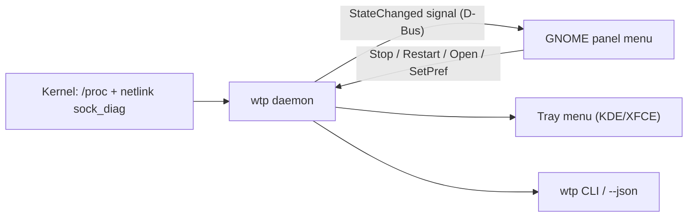

<div align="center">

# WhatThePort for Linux

**Every dev server on your machine, one click away in the top bar.**
A Linux port of [WhatThePort](https://github.com/tomjohndesign/what-the-port): a single Rust binary plus a GNOME Shell panel menu.

[](#requirements)
[](#building)
[](LICENSE)

</div>

---

## Why

Running several AI coding agents across git worktrees leaves orphaned `next dev`, `vite`, `uvicorn` and `cargo` processes holding ports and gigabytes of RAM. WhatThePort finds every local dev server, groups its whole process tree, names the project and branch, links the agent session that started it, and warns you before a leak sends your machine into swap.

## The panel menu

Click the dot-grid icon in the top bar. Everything is in that one menu:

```text
 ⠿ 3
┌────────────────────────────────────────────────┐
│ 3.4 GB  in 3 servers                  CPU 8.4% │
│ [████▒▒▒▓▓░░░░░░░░░░░░░░░░░░░░░░░░░░░░░░░░░░░] │
│ Other 7.1 GB  ·  Free 5.5 GB                   │
├────────────────────────────────────────────────┤
│ :3000  web-dashboard          ╱╲╱─  640 MB 🌐 ■ ›│  click a row to expand it
│        Fix OAuth callback · up 42m             │
│   Framework  Next.js 15                        │
│   Session    Claude Code: Fix OAuth callback   │
│   Command    next dev --turbopack -p 3000      │
│   Processes (3)                                │
│     pnpm dev                    42 MB · 0%     │
│       next dev --turbopack     118 MB · 0.4%   │
│         next-server            480 MB · 5.8%   │
│   [Open] [PR #128] [Restart] [Stop]            │
│ :5173  studio-vite            ▁▃▅▇ 2.18 GB 🌐 ■ ›│  amber: over threshold or leaking
│ :8000  billing-api            ────  268 MB 🌐 ■ ›│
│        Worktree deleted · up 5h                │
├────────────────────────────────────────────────┤
│ 🧹 Clean up 1 server                            │
│ ⚙ Settings                                   › │  thresholds, cleanup mode, toggles,
│ ⏻ Quit WhatThePort                             │  launch at login
└────────────────────────────────────────────────┘
```

- **Process trees**: wrapper chains (`pnpm` → `sh -c` → `next dev` → `next-server`) are reported as one server with combined memory and CPU.
- **Projects and branches** are read from `package.json`, `pyproject.toml`, `Cargo.toml`, `go.mod`, `Gemfile` and `.git/HEAD`, including linked worktrees.
- **Agent sessions**: servers started by Claude Code (`CLAUDE_CODE_SESSION_ID`) or Codex show the conversation title.
- **Alerts**: a desktop notification with **Stop** and **Mute alerts** buttons appears when a server passes the memory threshold (default 2 GB) or grows by more than 500 MB in 10 minutes.
- **Clean up**: servers from deleted worktrees, idle ones and long-running ones are suggested for cleanup (or stopped automatically, if you choose). Databases such as `postgres`, `redis-server`, `mysqld` and `mongod` are never stopped.
- **Stop and restart**: SIGTERM to the whole tree, then SIGKILL after 3 seconds for anything still running. Restart re-runs the original command in its original folder, logging to `~/.local/state/whattheport/port-N.log`.

On KDE Plasma, XFCE, Cinnamon and other desktops with a StatusNotifier tray, the same menu appears as a tray icon, with each server as a submenu.

## Terminal

```console
$ wtp
:3000   web-dashboard     640 MB    0.4%  Fix OAuth callback · up 42m
:5173   studio-vite      2.18 GB   12.0%  main · up 2h 15m
:8000   billing-api       268 MB      0%  Worktree deleted · up 5h · clean up: Worktree deleted

3.1 GB in servers · 7.1 GB other · 5.5 GB free · CPU 1.6%

$ wtp stop 8000
$ wtp restart 3000
$ wtp --json        # full state for scripts, Waybar, Polybar, tmux
```

When the background service is running, `wtp` reads its state (including CPU and 10-minute history); otherwise it does a quick scan itself.

## Requirements

- Linux with `/proc` (any modern distribution)
- GNOME Shell 45–50 for the panel menu, or any desktop with a StatusNotifier tray
- Rust 1.88+ to build (`curl --proto '=https' --tlsv1.2 -sSf https://sh.rustup.rs | sh`)
- Optional: GitHub CLI (`gh`) for pull request and Vercel preview links

There are no runtime dependencies: no Python, GTK or `ss`.

## Install

```bash
git clone https://github.com/devgg003/whattheport-linux.git
cd whattheport-linux
./install.sh
```

The installer builds the binary, installs `~/.local/bin/wtp`, the icons, an app launcher entry and the GNOME extension, removes any old Python version, and starts the service. On GNOME, log out and back in once so the shell loads the extension.

Launch **WhatThePort** from the app grid to start it again after quitting, or turn on **Settings → Launch at login**.

`./install.sh --uninstall` removes everything except your settings.

## Configuration

Most options are in the menu's **Settings** submenu. Everything lives in `~/.config/whattheport/config.json` (the same file as the Python version, so existing settings carry over):

| Key | Default | Description |
| :--- | :--- | :--- |
| `min_port` / `max_port` | `3000` / `65535` | Port range to watch |
| `scan_interval` | `2.0` | Seconds between scans |
| `threshold_gb` | `2.0` | Memory alert threshold |
| `leak_warnings` | `true` | Notify on high memory or >500 MB growth in 10 minutes |
| `snooze_minutes` | `60` | Minimum time between repeat alerts for one server |
| `cleanup_mode` | `"ask"` | `"off"`, `"ask"` (notify) or `"automatic"` (stop) |
| `cleanup_idle_hours` | `4` | Hours with no connections and under 2% CPU before a server counts as idle |
| `cleanup_running_days` | `3` | Days of uptime before suggesting cleanup |
| `cleanup_deleted_worktree` | `true` | Suggest stopping servers whose folder was deleted |
| `force_quit_seconds` | `3.0` | Grace period before SIGKILL |
| `allowlist` / `protected_processes` | `[]` | Extra process names to treat as servers / never stop |
| `link_claude` / `link_codex` | `true` | Show agent session titles |
| `show_branches` | `true` | Show the git branch |
| `github_pull_requests` / `vercel_previews` | `false` | Look up PRs and previews with `gh` |
| `tray` | `"auto"` | `"auto"` (tray everywhere except GNOME), `"on"` or `"off"` |

## How it works



One background service does all the work. It lists sockets straight from the kernel over netlink (no `ss` subprocesses), reads `/proc` once per scan, and only looks at command lines, environments and folders for processes that own a listening port. Each scan builds a ready-to-display view model and publishes it on the session bus as `dev.whattheport.WhatThePort` (`/dev/whattheport/Daemon`, interface `dev.whattheport.Daemon1`) only when something changed. The panel menu, tray and CLI just render it. A scan takes about 12 ms of CPU every 2 seconds, and the service uses about 6 MB of memory.

```text
src/
├── lib.rs        # scanner library (wtp_core)
├── sockets.rs    # netlink sock_diag listing, socket inode → PID, docker-proxy
├── procfs.rs     # /proc readers: stat, statm, cmdline, environ, cwd, meminfo
├── tree.rs       # process tree and shared-socket service grouping
├── scan.rs       # dev server detection, CPU deltas, 10-minute history
├── project.rs    # manifests, git branches and worktrees
├── agents.rs     # Claude Code and Codex session titles
├── model.rs      # Server model, attention and cleanup rules
├── control.rs    # stop (SIGTERM → SIGKILL), restart, open
├── github.rs     # PR / Vercel preview lookups via gh
├── prefs.rs      # ~/.config/whattheport/config.json
├── rules.rs      # built-in process heuristics
├── format.rs     # sizes, durations, colours
├── main.rs       # wtp command line
├── daemon.rs     # background service, D-Bus interface, alerts, cleanup
├── view.rs       # view model sent to every frontend
├── notify.rs     # desktop notifications with actions
├── tray.rs       # StatusNotifier tray menu
└── cli.rs        # terminal output and commands
gnome-extension/whattheport@local/   # panel icon and menu (GJS)
```

## Building

```bash
cargo build --release   # target/release/wtp
cargo test
```

## Credits & License

- Original macOS application designed and created by **[Tomjohn Design LLC](https://github.com/tomjohndesign/what-the-port)** ([whattheport.dev](https://whattheport.dev)).
- Released under the [MIT License](LICENSE).
