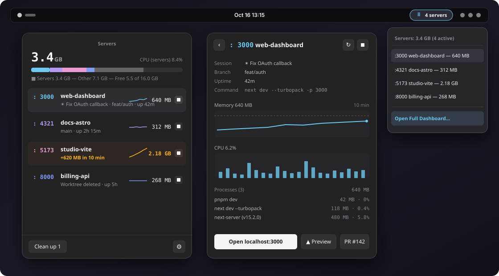
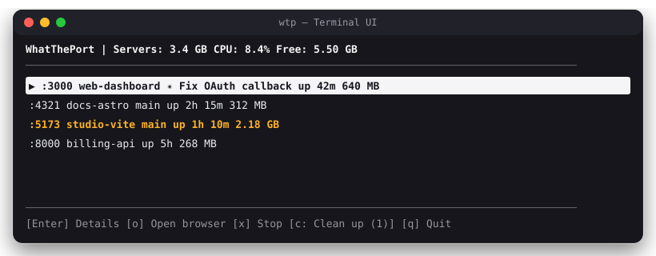
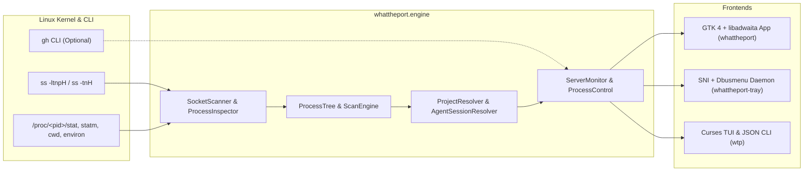

<div align="center">

# WhatThePort for Linux

**Dev servers in your Linux top bar and terminal.**  
A native Linux port of [WhatThePort](https://github.com/tomjohndesign/what-the-port) built with GTK 4, libadwaita, FreeDesktop `StatusNotifierItem`, and Linux `/proc`.

[](#requirements)
[](#ui-layout--anatomy)
[](#requirements)
[](LICENSE)

<br/>



</div>

---

## Why WhatThePort?

Modern development workflows—especially when running multiple AI coding agents (Claude Code, Codex) across git worktrees—quietly leave behind orphaned `next dev`, `vite`, `uvicorn`, and `cargo` processes eating gigabytes of RAM and occupying ports.

**WhatThePort for Linux** lives in your desktop top bar and terminal (`wtp`), discovering every active local dev server, grouping its entire process tree, resolving its project name and git branch, and flagging memory leaks or deleted worktrees before your machine swaps.

---

## Features

| Feature | Description |
| :--- | :--- |
| **Top-Bar System Tray (`whattheport-tray`)** | Native FreeDesktop `StatusNotifierItem` + `dbusmenu` indicator that works out of the box on Ubuntu GNOME, KDE Plasma, XFCE, and Cinnamon. Hover for RAM summary or click to open servers in a single click. |
| **Dark GTK 4 Dashboard (`whattheport`)** | Segmented whole-system memory bar (color-coded by `:port`), live Cairo sparklines, 10-minute memory & CPU history charts, and process tree inspector. |
| **Process Tree Ownership** | Walks `/proc/<pid>` parent/child hierarchies and shared socket fds so wrapper processes (`npm` → `sh` → `next-server`) report unified RSS memory and CPU usage. |
| **Project & Git Worktree Detection** | Automatically parses `package.json`, `pyproject.toml`, `Cargo.toml`, `go.mod`, `Gemfile`, and `.git/HEAD` (including linked git worktrees). |
| **AI Agent Session Linking** | Links dev servers directly to the **Claude Code** (`CLAUDE_CODE_SESSION_ID`) or **Codex** session that spawned them, displaying the conversation title. |
| **Leak & High-RAM Alerts** | Highlights servers in amber (`#FFB224`) and sends desktop notifications (`notify-send`) when a server exceeds your RAM threshold (default `2.0 GB`) or grows by `>500 MB` in 10 minutes. |
| **Smart Clean Up & DB Protection** | Recommends stopping servers from deleted git worktrees or long-idle ports while automatically protecting databases (`postgres`, `redis-server`, `mysqld`, `mongod`). |
| **Terminal UI & JSON CLI (`wtp`)** | Full interactive curses TUI (`wtp`) for SSH/terminal sessions plus machine-readable `wtp --json` output for scripts and status bars (Waybar, Polybar, tmux). |

---

## UI Layout & Anatomy

### 1. Main Dashboard (`whattheport`) & Detail View

```text
┌──────────────────────────────────────────┐     ┌──────────────────────────────────────────┐
│                 Servers                  │     │ [‹] : 3000  web-dashboard        [↻] [■] │
│ 3.4 GB                CPU (servers) 8.4% │     │                                          │
│ [████░░░░▒▒▒▒▓▓░░░░░░░░░░░░░░░░░░░░░░░░] │     │ Session   ✴ Fix OAuth callback           │
│ ■ Servers 3.4 GB ― Other 7.1 ― Free 5.5  │     │ Branch    feat/auth                      │
│──────────────────────────────────────────│     │ Uptime    42m                            │
│ : 3000  web-dashboard     ╱╲╱─  640 MB ■ │ ──▶ │ Command   next dev --turbopack -p 3000   │
│         ✴ Fix OAuth · feat/auth · up 42m │     │                                          │
│ : 4321  docs-astro        ────  312 MB ■ │     │ Memory  640 MB                    10 min │
│         main · up 2h 15m                 │     │ ┌──────────────────────────────────────┐ │
│ : 5173  studio-vite       ▁▃▅▇ 2.18 GB ■ │     │ │ - - - - - - - - - - (Threshold 2 GB) │ │
│         +620 MB in 10 min (Amber Alert)  │     │ │              ╭───────────●           │ │
│ : 8000  billing-api       ────  268 MB ■ │     │ └──────────────────────────────────────┘ │
│         Worktree deleted · up 5h         │     │ CPU  6.2%                                │
│──────────────────────────────────────────│     │ ┌──────────────────────────────────────┐ │
│ [ Clean up 1 ]                       [⚙] │     │ │  ▂▄▁▆▃▂▁▅▂▁▂▇▄▂▁▃▂▄▂▃               │ │
└──────────────────────────────────────────┘     │ └──────────────────────────────────────┘ │
                                                 │ Processes (3)                     640 MB │
                                                 │   pnpm dev                      42 MB·0% │
                                                 │     next dev --turbopack     118 MB·0.4% │
                                                 │       next-server (v15.2.0)  480 MB·5.8% │
                                                 │                                          │
                                                 │ [ Open localhost:3000 ] [▲ Preview] [PR] │
                                                 └──────────────────────────────────────────┘
```

### 2. Terminal UI (`wtp`)

<div align="center">

</div>

---

## Requirements

- **OS**: Linux (Ubuntu 22.04+, Debian 12+, Fedora 39+, Arch Linux)
- **Python**: `3.10+`
- **System Packages**: GTK 4, libadwaita, PyGObject + Cairo bindings, `ss` (`iproute2`), and `libnotify` (`notify-send`)
- **Optional**: GitHub CLI (`gh`) for Vercel preview and Pull Request badges

### Install System Dependencies

<details open>
<summary><b>Ubuntu / Debian / Pop!_OS / Linux Mint</b></summary>

```bash
sudo apt update
sudo apt install python3-gi python3-gi-cairo gir1.2-gtk-4.0 gir1.2-adw-1 iproute2 libnotify-bin
```
</details>

<details>
<summary><b>Fedora / RHEL</b></summary>

```bash
sudo dnf install python3-gobject cairo-gobject gtk4 libadwaita iproute libnotify
```
</details>

<details>
<summary><b>Arch Linux / Manjaro</b></summary>

```bash
sudo pacman -S python-gobject python-cairo gtk4 libadwaita iproute2 libnotify
```
</details>

---

## Installation

Clone the repository and run the installer script:

```bash
git clone https://github.com/devgg003/whattheport-linux.git
cd whattheport-linux
./install.sh
```

### What `./install.sh` Sets Up

| Component | Installed Path | Purpose |
| :--- | :--- | :--- |
| **`whattheport`** | `~/.local/bin/whattheport` | Launches or toggles the GTK 4 dark dashboard window |
| **`whattheport-tray`** | `~/.local/bin/whattheport-tray` | Background FreeDesktop `StatusNotifierItem` top-bar indicator daemon |
| **`wtp`** | `~/.local/bin/wtp` | Interactive terminal UI and `--json` CLI |
| **Desktop Entry** | `~/.local/share/applications/dev.whattheport.WhatThePort.desktop` | Adds **WhatThePort** to your desktop application launcher |
| **Autostart Entry** | `~/.config/autostart/whattheport-tray.desktop` | Automatically starts the top-bar tray icon when you log in |

> **Note:** Ensure `~/.local/bin` is in your shell's `PATH`:
> ```bash
> export PATH="$HOME/.local/bin:$PATH"
> ```

---

## Usage

### Desktop GUI & Top-Bar Tray
- **Top-Bar Indicator**: Click the WhatThePort server icon in your top bar to see active ports and total RAM, click any server to open `http://localhost:<port>` in your default browser, or click **Open Full Dashboard…**.
- **Dashboard Window**: Run `whattheport` from a terminal or launch **WhatThePort** from your desktop app launcher (GNOME Activities / Rofi / Ulauncher).
- **Stop / Restart**: Click the stop button (`■`) on any row to gracefully `SIGTERM` the entire process tree (escalating to `SIGKILL` after 3 seconds if any child process hangs), or open a server's detail view and click `↻` to restart it in-place.

### Terminal UI (`wtp`)
Run `wtp` in any terminal:

```bash
wtp
```

| Key | Action |
| :--- | :--- |
| <kbd>↑</kbd> / <kbd>↓</kbd> or <kbd>j</kbd> / <kbd>k</kbd> | Navigate server list |
| <kbd>Enter</kbd> | Toggle server detail & process tree view |
| <kbd>o</kbd> | Open selected server (`http://localhost:PORT`) in default browser |
| <kbd>x</kbd> | Stop selected server (or all checked servers in Clean Up mode) |
| <kbd>c</kbd> | Enter / exit **Clean Up** multi-select mode |
| <kbd>Space</kbd> | Toggle server selection in Clean Up mode |
| <kbd>q</kbd> / <kbd>Esc</kbd> | Back / Quit |

### JSON CLI (`wtp --json`)
Query active dev servers programmatically for scripts, Waybar, Polybar, or AI agents:

```bash
wtp --json
```

```json
[
  {
    "port": 3000,
    "name": "web-dashboard",
    "pid": 48210,
    "root_pid": 48192,
    "command": "next dev --turbopack -p 3000",
    "cwd": "/home/user/projects/web-dashboard",
    "cwd_exists": true,
    "branch": "feat/auth",
    "agent": "Fix OAuth callback",
    "uptime_seconds": 2541.2,
    "memory_bytes": 671088640,
    "cpu_percent": 6.2,
    "attention": false,
    "leaking": false,
    "url": "http://localhost:3000"
  }
]
```

---

## Configuration

Settings can be configured via the **⚙ Settings** button in the GUI or by editing `~/.config/whattheport/config.json`:

| Key | Default | Description |
| :--- | :--- | :--- |
| `min_port` | `3000` | Lowest TCP port to scan |
| `max_port` | `65535` | Highest TCP port to scan |
| `scan_interval` | `2.0` | Seconds between process & socket scans |
| `threshold_gb` | `2.0` | Memory alert threshold in GB |
| `leak_warnings` | `true` | Send desktop notification on high memory or `>500 MB` growth in 10m |
| `cleanup_mode` | `"ask"` | `"off"`, `"ask"` (notify & badge), or `"automatic"` (auto-stop idle/deleted worktree servers) |
| `cleanup_deleted_worktree` | `true` | Flag servers whose working directory / git worktree was deleted |
| `cleanup_idle_hours` | `4` | Hours of zero connections and `<2%` CPU before flagging as idle |
| `cleanup_running_days` | `3` | Days of continuous uptime before suggesting cleanup |
| `link_claude` | `true` | Resolve Claude Code session titles from `~/.claude/projects` |
| `link_codex` | `true` | Resolve Codex session titles from `~/.codex/sessions` |
| `show_branches` | `true` | Display current git branch or commit SHA |
| `vercel_previews` | `false` | Query `gh api` for Vercel preview deployments on the active branch |
| `github_pull_requests` | `false` | Query `gh pr list` for open/merged PRs on the active branch |

---

## Architecture



```text
whattheport-linux/
├── assets/                          # SVG UI screenshots & terminal previews
├── whattheport/
│   ├── engine/
│   │   ├── scanner.py               # TCP listening socket & inbound connection scanner (ss)
│   │   ├── procs.py                 # Direct /proc/<pid> RSS, CPU ticks, cmdline & environ reader
│   │   ├── tree.py                  # Process tree & shared socket ownership resolver
│   │   ├── project.py               # Manifest parser (Node, Python, Rust, Go, Ruby) & git worktrees
│   │   ├── agents.py                # Claude Code & Codex session transcript resolver
│   │   ├── github.py                # Asynchronous GitHub PR & Vercel preview lookup via gh
│   │   ├── scanner_engine.py        # 10-minute rolling history & CPU/memory delta engine
│   │   ├── monitor.py               # Background polling loop, alerts & cleanup recommendations
│   │   ├── control.py               # Safe SIGTERM -> SIGKILL tree termination & in-place restart
│   │   ├── prefs.py                 # User preferences (~/.config/whattheport/config.json)
│   │   └── format.py                # Port color palette & human-readable byte/duration formatters
│   ├── gui/
│   │   ├── app.py                   # GTK 4 / libadwaita single-instance application
│   │   ├── popover.py               # Main dashboard window, segmented memory bar & cleanup mode
│   │   ├── server_row.py            # Server list item with inline sparkline & amber badges
│   │   ├── detail.py                # 10-min charts, process hierarchy & browser/PR actions
│   │   ├── charts.py                # Custom Cairo DrawingArea widgets (MemoryBar, Sparkline, DetailChart)
│   │   ├── settings.py              # Adw.PreferencesWindow configuration dialog
│   │   ├── style.css                # Dark popover stylesheet
│   │   └── tray_status_notifier.py  # FreeDesktop StatusNotifierItem + com.canonical.dbusmenu service
│   └── tui/
│       └── wtp.py                   # Curses interactive terminal UI & --json CLI
├── tests/                           # Unit & smoke test suite
├── install.sh                       # Desktop & CLI installer script
└── pyproject.toml                   # Standard Python package metadata
```

---

## Uninstallation

To remove WhatThePort from your system:

```bash
pkill -f "whattheport" || true
rm -rf ~/.local/share/whattheport \
       ~/.local/bin/whattheport \
       ~/.local/bin/whattheport-tray \
       ~/.local/bin/wtp \
       ~/.local/share/applications/dev.whattheport.WhatThePort.desktop \
       ~/.config/autostart/whattheport-tray.desktop
```

---

## Credits & License

- Original macOS application designed and created by **[Tomjohn Design LLC](https://github.com/tomjohndesign/what-the-port)** ([whattheport.dev](https://whattheport.dev)).
- Released under the [MIT License](LICENSE).
